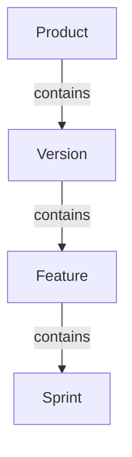

<!--
Copyright (C) 2025-2026 Abdalla Bushnaq
Licensed under the Apache License, Version 2.0 (the "License");
you may not use this file except in compliance with the License.
You may obtain a copy of the License at

    http://www.apache.org/licenses/LICENSE-2.0

Unless required by applicable law or agreed to in writing, software
distributed under the License is distributed on an "AS IS" BASIS,
WITHOUT WARRANTIES OR CONDITIONS OF ANY KIND, either express or implied.
See the License for the specific language governing permissions and
limitations under the License.
-->

# UI help-page design and standards

## Scope and architecture

The pilot covers the Products page (`ProductListView`) and its Create/Edit Product
dialog (`ProductDialog`). Other views and dialogs can opt in without
changing their shared base class or the main navigation.

| Surface                                                                   | Responsibility                                                                                    |
|---------------------------------------------------------------------------|---------------------------------------------------------------------------------------------------|
| `ui\component\HelpDrawer.java`                                            | Owner-attached, non-modal Vaadin Dialog styled as a right-side drawer, with an accessible toggle. |
| `ui\component\HelpMarkdown.java`                                          | UTF-8 classpath loading, shared chapter inclusion and Vaadin's native Markdown component.         |
| `src\main\frontend\help\help-markdown.ts`                                 | Local, lazy Mermaid rendering and theme-paired screenshots.                                       |
| `src\main\frontend\help\help.css`                                         | Scoped drawer, Markdown and diagram presentation.                                                 |
| `src\main\resources\help\<route>.md`                                      | Version-controlled help content.                                                                  |
| `src\main\resources\help\product-dialog.md`                               | Create/Edit Product dialog help, separate from the list page.                                     |
| `src\main\resources\help\shared\*.md`                                     | Reusable table, filtering/sorting and Undo/Redo chapters.                                         |
| `src\main\resources\META-INF\resources\ui\images\help\light\` and `dark\` | Bundled screenshot pairs, served through the existing UI image path.                              |

No runtime connection to the wiki checkout, a CDN or a diagram service is needed.
Mermaid is pinned with Vaadin's `@NpmPackage` annotation and recorded in the npm
manifest/lockfile. Its JavaScript is dynamically imported only when a connected
help page contains a Mermaid diagram. The small help integration module and styles
are part of the normal Vaadin frontend.

The drawer overlays the right side rather than resizing the existing AI split
layout. It uses up to 72rem and fits the viewport on narrow screens. Screenshots
use the available width; prose is limited to 75 characters per line for readability.
The native non-modal Dialog overlay handles layering and keyboard/focus behavior,
including help opened from a modal product form. Opening focuses Close; Close and
Escape return focus to the invoking Help button. Navigating away closes the
view-owned drawer. Closing a product form also closes its help.

Unreadable help resources are logged and reported through a notification. Invalid
diagram content or a failed module load displays a visible error in place of the
diagram; the accompanying prose remains available.

## Adding help to a view

Create `help\<route>.md`, then attach a drawer to the view and add its toggle to the
existing smart header:

```java
HelpDrawer helpDrawer = new HelpDrawer("Products", "help/product-list.md");

addHeaderButton(helpDrawer.createToggleButton(PRODUCT_HELP_BUTTON));

add(helpDrawer);
```

Use a stable, page-specific button ID. The drawer derives its own ID from it
and uses a native dialog title. Add Javadoc to any new public constants/methods. Do not automatically
open help or persist its open state across different views.

For a dialog, attach the drawer as a child, put its toggle in the dialog header,
and close help from the owner's opened-change listener when the owner closes.
Use a dialog-specific help resource. Do not put dialog field walkthroughs in the
list page's help; explain the task there and direct users to the form's Help button.

Keep help under the view's existing authorization. Do not expose private entity
data, tokens or operational settings in static help assets. Only bundled,
reviewed help resources are accepted; this component is not an arbitrary
user-supplied Markdown viewer.

## Content template

Use short, task-oriented English with these sections when applicable:

Focus on non-obvious behavior and the user's task. Keep implementation and design
decisions in this standards document, not in user-facing help. Do not repeatedly
explain that filtering leaves data unchanged or that access limits the rows shown.
Use Kassandra's domain terminology: **product**, not project.

1. **Purpose and concepts**: what the page manages and a relationship diagram if useful.
2. **Find your way around**: annotated screenshot and short control legend.
3. **The table**: shared interaction guidance, followed by page-specific columns and row navigation.
4. **Filtering and sorting**: its own shared chapter, followed by page-specific examples.
5. **Page actions**: creating, editing and deleting, expressed as tasks and outcomes.
6. **Undo and redo**: history control, product scope and confirmation.
7. **Optional features**: availability and permission conditions.

Dialog help has its own field legend, task instructions, access defaults, optional
features, and Save/Cancel behavior. State what happens when optional fields are
left empty. For product creation, the creator is granted access automatically
and administrators have role-based access; do not describe an empty collaborator
selection as granting everybody access.

Describe controls by what users can accomplish, not merely which dialog opens:
"Edit the product name or generate a new icon/header" rather than "Opens Edit
Product." Explain deletion and its recoverability through recorded history.
Do not treat filtering, sorting or navigation as saved changes.

### Shared chapters

Include a shared chapter on its own line using a stable lowercase name:

```markdown
{{include:table}}

### Product columns and navigation

Page-specific column meanings and row navigation.

## Filtering and sorting

Filter image for this page.

{{include:filtering}}

### Product filter examples

Page-specific queries.

{{include:sorting}}

## Undo and redo

{{include:undo-redo}}
```

The renderer expands these directives from `help\shared\<name>.md` before passing
the complete document to native Markdown. Names allow only lowercase letters,
digits and hyphens. Includes are deliberately one-level: shared chapters cannot
include other files. Missing files and malformed/nested directives fail explicitly.
Do not duplicate shared chapter text across help pages or include it where the
underlying page does not support the described behavior.

The drawer supplies the page title. For ordinary help pages, start Markdown at
`##` rather than repeating a top-level title; the collapsible pilot below starts
with an introduction instead. Use ordinary headings, paragraphs, lists, tables,
images and fenced Mermaid. Avoid custom HTML and scripts.

### Collapsible chapters: Features pilot

Features opts in using `new HelpDrawer("Features", "help/feature-list.md", true)`.
The existing two-argument constructor keeps other pages and dialog help unchanged.
`HelpMarkdown` composes native Vaadin `Details` components containing native
Markdown; no custom HTML or additional dependency is needed.

Write a short, always-visible introduction before the first `##` heading.
Each `##` heading starts an initially collapsed, task-oriented chapter;
use `###` for headings inside it. Chapters can be opened independently.
**Expand all** makes the complete help readable and available to browser Find;
**Collapse all** restores the overview. Closing and reopening the same drawer
retains chapter choices; a newly created view starts collapsed.

Chapter boundaries are determined before shared includes are expanded. Included
headings remain inside their owning chapter, and headings inside backtick or tilde
code fences are not chapter boundaries. Use plain text for chapter titles.
Do not introduce nested collapsible sections or a chapter for every control.

The Features pilot groups finding/comparing work, creating/editing/deleting,
recovery, main-menu/header guidance, AI assistance and troubleshooting.
Reusable main-menu guidance lives in `help\shared\main-menu.md`; keep
page-specific creation, history and assistant context in the page's own content.
Existing screenshot pairs and theme switching still apply inside chapters.

### Role-aware shared help

Use `{{include:main-menu}}` for common navigation/account guidance and
`{{include-admin:main-menu-admin}}` for the administrator supplement.
`HelpMarkdown` includes the supplement server-side only when `SecurityUtils.isAdmin()`
is true, matching the actual menu. Do not duplicate complete user/admin help pages.
The same one-level include and filename restrictions apply to both directives.

The trusted `{{audience}}` placeholder resolves to `user` or `admin` for
role-specific screenshot paths. Use it for navigation and expanded account menus
whose visible contents differ by role. This is documentation selection, not a
replacement for endpoint or view authorization.

Document observed behavior, not intended future behavior. Confirm existing
introduction-video narration against current UI code and screenshots. The pilot's
workflow reference is
`ProductsVersionsFeaturesAndSprintsIntroductionVideo09IT`: Jupiter, version
1.0.0, Config server and Minimum Viable Product. Do not copy narration verbatim;
turn it into concise task instructions.

## Referring to controls

Users do not know Java identifiers or DOM IDs. Use the exact visible label in
bold, supplemented by its icon and location where useful:

- **Create (+)** at the upper right.
- The **pencil/notepad icon** in the product row's **Actions** column.
- **Grant Access to Groups** in the Create Product dialog.

For unlabeled icons, describe both appearance and purpose. For select boxes,
give the visible field label, whether multiple values are allowed and what to
select. Do not identify a control only by color, coordinates or a screenshot
number. Explain controls that appear only with a service or permission.

Page help and filter-specific help are distinct. Page toggles use
`Help: <page>` for both the accessible name and tooltip. Existing filter help
continues to explain filter syntax.

## Screenshots

### Page and control images

Page help uses independently captured controls instead of numbered full-page images.
Use a control image followed by editable Markdown describing its label, location
and outcome. Images supplement the text; they must not be the only instructions.
Small controls retain their natural size rather than being enlarged to drawer width.

`GenerateScreenshotsIT.takeScreenshots` is the sole screenshot-generation entry point.
It restores the existing showcase database snapshot, or generates and saves it when
no usable snapshot exists. The same populated fixture is used for full-page and
dialog screenshots, page-help controls, and shared administrator/user navigation
in both themes. Features is part of this tour, not a separate minimal-data capture.
Run it from the IDE or use the existing production frontend for a headless capture:

```bash
mvn -Pproduction test -Dtest="GenerateScreenshotsIT#takeScreenshots" -Dselenium.headless=true -Dvaadin.productionMode=true
```

Generated files belong to the application, not the wiki:
`src\main\resources\META-INF\resources\ui\images\help\<theme>\FeatureListView\`.
Folder names match view class names; filenames use DOM ID values, such as
`create-feature-button.png`. Do not introduce a second set of screenshot names.
Dynamic row actions use their DOM ID prefix without the entity-specific suffix,
for example `feature-grid-edit-button-prefix-.png`. Give referenced controls a
page-specific ID when needed. Filter help uses `<filter-id>-help-button`.

Reusable capture code belongs in `SeleniumHandler`: `takeHelpElementScreenshot`,
`takeHelpRowActionScreenshot` and `takeHelpGridScreenshot`. These methods derive
the output folder and active theme automatically. Use `setHelpScreenshotTheme`
and `prepareHelpScreenshots` before capturing a page. `GenerateScreenshotsIT`
owns the page-specific element list and fixture/navigation setup only.

Shared header controls belong to `MainLayout`, not the page used to capture them:
`src\main\resources\META-INF\resources\ui\images\help\<theme>\MainLayout\`.
Role-dependent images use `admin\` and `user\` subfolders. The optional variant
argument to `takeHelpElementScreenshot` selects that subfolder.
`takeHelpMenuScreenshot` captures the expanded popup as `<menu-id>-popup.png`,
separately from its trigger. Preserve route IDs used for navigation; assign
screenshot-safe IDs to inner tab content instead.
Use `takeHelpContentScreenshot` for horizontal groups such as breadcrumbs and
navigation strips to crop unused trailing space without resizing the live UI.
Help controls are cropped from a viewport screenshot, not captured with Selenium's
native element-screenshot command. Already-visible capture areas do not scroll;
off-screen areas use only the necessary scrolling in their containers and the page,
then wait two animation frames before capture. Crops account for screenshot pixel
scaling. Scroll distances round outward to avoid leaving fractional-pixel edges
clipped when the browser rounds scroll positions. Scroll-container bounds also
respect fractional border-box edges because integer client dimensions can round
past the actual clipping edge. A clipped area fails explicitly
instead of saving a partial image.
Large panels explicitly captured with `takeHelpVisibleElementScreenshot` are the
exception: the Active Sprints chart and board use a top-left-aligned visible crop
when they exceed their scroll container. The cropped CSS dimensions are logged.
This does not relax complete-image checks for ordinary controls, resize the live
panel, or invoke native element screenshots. These panel images intentionally
show only the portion that fits on screen.
Help preparation parks the pointer at the viewport corner without scrolling to or
hovering the first control. No elements are cloned, repositioned or resized.

The tour's private MainLayout capture helper regenerates the logo, navigation
entries, breadcrumbs, history/theme toggles, account trigger/popup and individual
account-menu entries in both themes. It uses isolated browser sessions for
Christopher Paul (administrator) and Jennifer Holleman (regular user), checks the
signed-in account and captures both roles against the showcase product/version.
Add future page and dialog elements incrementally to explicit capture lists,
reusing these helpers and stable IDs rather than introducing a DOM crawler.

Non-capture verification belongs outside `GenerateScreenshotsIT`.
`PageHelpResourcesTest` checks packaged Markdown, shared includes and referenced
image variants as a lightweight `UnitTest`, without Spring, a database or a browser.
`PageHelpIT` checks empty/rebuilt views, collapsible chapters, theme-specific images
and administrator/user help using isolated UI test data. Neither generates images
or loads the expensive showcase fixture.

The capture routine explicitly lists help-referenced elements; it does not crawl
every DOM node. Buttons and selectors are captured individually; grids include
their headings and only the first populated row. Missing controls, missing rows
and invalid images fail the capture rather than producing full-page fallbacks.
Add a capture entry when documenting a new control. Regeneration overwrites the
same named assets, leaving Markdown references and other controls unaffected.
The full wiki capture also refreshes these element images when it visits Features.

```markdown


Use **Create (+)** at the upper right to add a feature.
```

Review and commit regenerated light/dark pairs together. Rebuild after capture
to include refreshed source images in the packaged application; an already
running server can still have the previous classpath copies. Help uses the existing
theme switching and UI image serving; no external files or new endpoint are needed.

### Avoiding unchanged screenshot commits

`GenerateScreenshotsIT` compares each new help or wiki screenshot with the existing
destination before writing it. Equivalent images leave the existing file untouched,
including its PNG bytes and modification time. The candidate stays in memory; no
second baseline directory or Git maintenance command is needed.

The default comparison requires identical dimensions and alpha, with a maximum
difference of **4 out of 255 in each RGB channel at every pixel**. This ignores small
colour-rendering differences and PNG encoding/metadata differences, but not shifted
text or a small high-contrast change. Small intentional colour changes within the
tolerance are also ignored. Comparison always uses the retained image, preventing
cumulative drift from being hidden by successive discarded captures.

Set `-Dscreenshot.channel-tolerance=0` in the test run's JVM options for exact pixel
comparison, or another integer from 0 to 255 to adjust the tolerance. Set
`-Dscreenshot.force-refresh=true` to replace all captured documentation images,
including intentional changes below the tolerance. Unreadable existing images and
write failures fail the capture rather than being treated as unchanged.

These options apply only to bundled help images and the wiki's light/dark screenshot
directories during `GenerateScreenshotsIT`. Ordinary diagnostic screenshots remain
unconditional. Existing modified PNGs are not reverted to their committed versions.

### Screenshot discrepancy report

At the end of `GenerateScreenshotsIT`, including failed capture runs, a UTF-8 CSV is
written to `target\screenshot-discrepancies.csv`. It covers all completed help and wiki
captures across the test's parameterized invocations. The summary logs the maximum
RGB-channel difference (0–255) and every PNG tied for that maximum.

Rows are sorted by descending maximum RGB difference, then PNG path. Each row includes
the absolute PNG path, retained/updated status, configured tolerance, force-refresh flag,
old/new dimensions, maximum RGB difference, changed-pixel count and percentage,
alpha-changed-pixel count, and pixel counts exceeding RGB tolerances **8, 16, and 32**.
A pixel exceeds a threshold when **any** RGB channel exceeds it; it is counted only once.
Changed pixels include RGB or alpha differences. Alpha must still match exactly,
regardless of RGB tolerance. A high maximum affecting very few pixels differs from
widespread changes; use the counts to assess whether increasing tolerance is appropriate.

New images (`CREATED`), dimension changes (`DIMENSIONS_CHANGED`), and forced captures
(`FORCED`) sort after comparable pairs and have blank difference metrics, not zeroes.
Force-refresh continues to bypass baseline decoding/comparison; its previous dimensions
are therefore also blank. The report observes the existing replacement rules and does
not change tolerance or preserve copies of overwritten baselines.

### Full-page images

Use the wiki's `light-screenshots` and `dark-screenshots` as source material,
but copy selected images into the application. Never link to `..\kassandra.wiki`
at runtime. Check screenshots for personal/confidential data before copying.

Use matching crops and numbered callouts in both themes. Crop empty space to
keep screenshots readable in a narrow drawer. Supply a text legend with the same
numbers, descriptive alternative text and a note that example data may differ.
For dense screenshots, describe controls in prose rather than relying on tiny
labels. At desktop drawer width, callout numbers must remain readable at their
rendered size. Use detail crops if a full-page image would make them too small.
Keep referenced top-navigation controls, such as history, visible in the image.
Redact user-identifying content that is not relevant to the explanation.
Refresh both images when the referenced UI changes.

Images under `images/help/light/` or `images/help/dark/` are theme pairs. Their
theme path segment switches with the active Lumo theme. Both files must exist:

```markdown

```

The relative URL resolves from Vaadin's `/ui/` base to `/ui/images/help/`, using
the application's existing image resource/security mapping, including deployments
using a context path. Do not introduce a separate root-level asset endpoint.
Only help image path
pairs use this convention; ordinary image links are unchanged.

## Mermaid diagrams

Vaadin 25's native Markdown renderer uses `marked` and DOMPurify; it does not
render Mermaid itself. The help component recognizes `mermaid` fenced code blocks
after native Markdown rendering and replaces them with locally generated SVG.
Ordinary code fences remain code.

Use diagrams for relationships, lifecycles or decision paths, not as substitutes
for instructions or screenshots. Prefer compact vertical flowcharts in the drawer.
Label arrows where their meaning is not obvious.

````markdown


A product contains versions, each version contains features, and each feature
contains sprints.
````

Every diagram requires `accTitle`, `accDescr` and an equivalent prose explanation.
Do not encode meaning in color alone. Keep labels short and use plain text rather
than HTML labels. Check both light/dark rendering and narrow layouts.

Mermaid runs with `securityLevel: 'strict'`, `startOnLoad: false` and HTML labels
disabled. Do not add click handlers, remote resources, initialization directives
or diagram-specific security/theme overrides. No Mermaid event bindings are
installed. Rendering is scoped to the help element, serialized because Mermaid
configuration is global, and repeated from preserved source when the UI theme
changes. Observers disconnect when the help element leaves the DOM; outdated
asynchronous results are not applied.

## Review checklist

Confirm the resource loads from the packaged application; the help button, close,
Escape and focus restoration work; navigation removes the panel; both screenshot
pairs load; diagrams render in both themes; broken diagrams show an error; and
small screens remain usable. Confirm existing page actions and the AI pane still
work. Follow the repository's existing build, formatting and UI test conventions.
