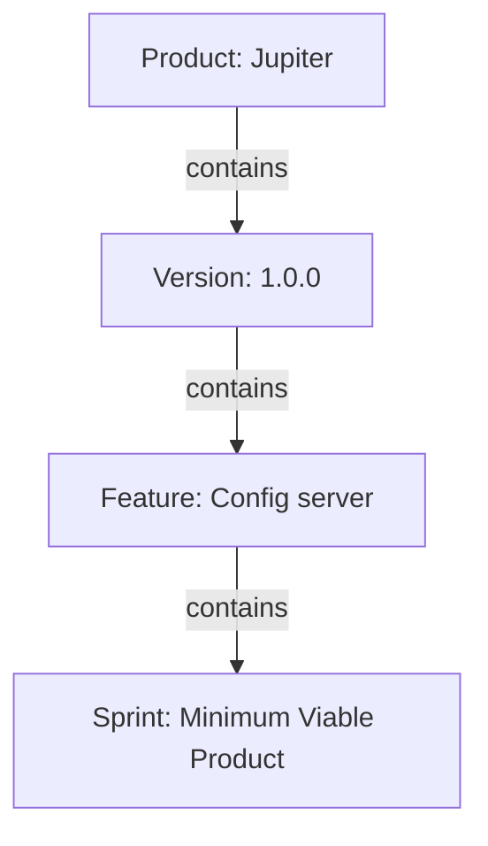

<!--
Copyright (C) 2025-2026 Abdalla Bushnaq
Licensed under the Apache License, Version 2.0 (the "License");
you may not use this file except in compliance with the License.
You may obtain a copy of the License at

    http://www.apache.org/licenses/LICENSE-2.0

Unless required by applicable law or agreed to in writing, software
distributed under the License is distributed on an "AS IS" BASIS,
WITHOUT WARRANTIES OR CONDITIONS OF ANY KIND, either express or implied.
See the License for the specific language governing permissions and
limitations under the License.
-->

## What are products?

A product groups the work you want to plan and track. The **Products** page lists
the products available to you.

A product can have multiple **versions**, each version multiple **features**, and
each feature multiple **sprints**.

## Find your way around

The screenshot shows example data; your products and available controls may differ.
The page Help button is beside **AI**; the question mark beside the filter
opens filter-specific help instead.

| Reference | Control                                              | What it does                                                       |
|-----------|------------------------------------------------------|--------------------------------------------------------------------|
| 1         | **AI powered filter**, beside the Products heading   | Find products using the filtering instructions below.              |
| 2         | **Create (+)**, at the upper right                   | Add a product. The dialog has its own Help button.                 |
| 3         | A row in the table                                   | Click a row to go to the versions listed for that product.         |
| 4         | **Access** badges                                    | See how many users and groups have explicitly been granted access. |
| 5         | Pencil/notepad icon, in the row's **Actions** column | Edit the product name or generate a new icon/header.               |
| 6         | Trash-can icon, in the row's **Actions** column      | Delete a product you no longer need.                               |
| 7         | **AI**, at the upper right                           | Opens or closes the AI assistant pane.                             |
| 8         | History button, in the top navigation                | Undo or redo recorded changes for a product.                       |

{{include:table}}

### Product columns and navigation

| Column      | Meaning                                          |
|-------------|--------------------------------------------------|
| **Key**     | The product's identifier.                        |
| Icon        | A visual identifier for the product.             |
| **Name**    | The product's name.                              |
| **Access**  | Counts of explicit user and group access grants. |
| **Created** | When the product was created.                    |
| **Updated** | When it was last updated.                        |
| **Actions** | Edit and delete controls for this product.       |

**Clicking a row in the table takes you to the versions listed for that product.**
Selecting a version on the next page takes you to its features; selecting a
feature takes you to its sprints.

**Access** badges count explicit grants, including the creator's automatic user
grant. They do not count every individual member of a granted group or
administrators' role-based access.

{{include:filtering-sorting}}

### Product filter examples

Try a product name such as **Jupiter**, **name contains Jupiter**, or **products created after January 2024**. The
question mark beside the filter
provides more examples. AI-powered filtering requires an available AI service.

## Create and edit products

Use **Create (+)** at the upper right to add a product. Use the **pencil/notepad icon** in a row's **Actions** column to
edit the product name
or generate a new icon/header.

The Create/Edit Product dialog has its own **Help button in the dialog header**
for its fields, image generation, access settings, saving and cancelling.

**Default access:** if no additional users or groups are selected when a product
is created, its creator and administrators can access it. Other users need an
explicit grant or membership in a granted group. Product access also covers its
versions, features and sprints.

## Delete a product

You can delete a product you no longer need using the **trash-can icon** in that
row's **Actions** column. Check the
product name in the confirmation before selecting **Delete**. Cancel the
confirmation if you do not want to delete it.

**Warning:** deleting a product also removes its contained work from the active
lists. You can restore a recorded deletion through that product's Undo/Redo
history. Do not use deletion merely to hide a product from the table.

{{include:undo-redo}}

## Use the AI assistant

Select **AI** at the upper right to open the assistant alongside the product list.
Select it again to close the assistant. Help and the assistant are independent.
AI features require configured, available services and operate with your access
permissions.

## Close help

Select the **X** at the top of this drawer, or press **Escape** while focus is
inside it. Closing help returns focus to the Help button that opened it. Opening help
does not change products, filters or the AI conversation.
