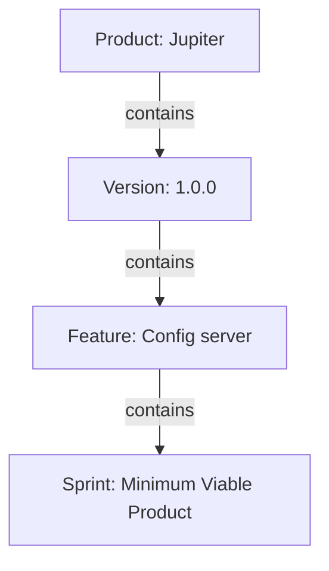

<!--
Copyright (C) 2025-2026 Abdalla Bushnaq
Licensed under the Apache License, Version 2.0 (the "License");
you may not use this file except in compliance with the License.
You may obtain a copy of the License at

    http://www.apache.org/licenses/LICENSE-2.0

Unless required by applicable law or agreed to in writing, software
distributed under the License is distributed on an "AS IS" BASIS,
WITHOUT WARRANTIES OR CONDITIONS OF ANY KIND, either express or implied.
See the License for the specific language governing permissions and
limitations under the License.
-->

## Organize work by product

A **product** is the starting point for planning and tracking a body of work.
Use this page to open an existing product, start a new one, or manage who can
work on it. You see only products you have access to; administrators see all
products.

A product can have multiple **versions**, each version multiple **features**, and
each feature multiple **sprints**. Stories, tasks and their worklogs belong to
the work planned inside those sprints.

## Open the work you want to plan

Choose a product row to open its **versions**. From there, choose a version to
reach its **features**, then a feature to reach its **sprints**. Opening a row
does not edit the product.

{{include:table}}

## Find a product

{{include:filtering}}

Try **Jupiter** to find a product by name, or **products created after January
2024** when you know when it was added. Filtering changes the visible list,
not the products themselves or anyone's access.

The question mark **beside the filter** opens search examples, not this page's
help.

{{include:sorting}}

## Start a new product

Use **Create** for a separate body of work. If you are planning another release
of an existing product, open that product and add a **version** instead.

Choose a required, unique product name and any collaborators, then **Save**.
Creating a product does not create its versions, features or sprints.
The dialog's own **Help** explains access settings and optional images.

## Change a product or its collaborators

Use the row's **edit action** to rename the existing product, change its access
grants, or choose an icon/header. Renaming does not create a new product or move
its contained work. **Save** applies your changes; **Cancel** discards unsaved
form changes.

Access is managed at the **product level** and also governs its versions,
features and sprints. The creator receives a user grant automatically;
administrators have role-based access. Without additional grants, other users
cannot access the product.

The **Access** badges count explicit user and group grants, not the total number
of people who can access the product. A group counts as one grant regardless of
its membership; administrators are not added to the count just for being
administrators.

Removing a user's explicit grant does not remove access they still have through
a granted group or an administrator role. Conversely, removing your own last
grant can make the product disappear from your list.

## Remove a product and its work

**Delete removes the product and its versions, features, sprints, stories,
tasks and worklogs from the active planning data.** It is not a way to hide one
row or revoke one person's access. Use filtering to narrow your list, or edit
the product's access grants to change its collaborators.

Check the product named in the confirmation before proceeding. To recover a
recorded deletion, open history from the Products page.

## Recover a recorded change

{{include:undo-redo}}

## Ask the assistant for help with your work

The **AI** button opens or closes the assistant alongside the list. You can ask
about products or request changes; it operates with your access permissions.
Be explicit about the product you mean when several have similar names.
Opening the assistant alone does not change a product.

The assistant needs configured, available AI services. It is separate from both
the filter and optional image generation in the product dialog.

## If a product is missing

Clear the text filter first. If the product is still absent, ask a collaborator
or administrator to check your user and group grants. Filtering cannot reveal
a product you do not have access to. If the product was deleted, check its
recorded history rather than creating a replacement.
